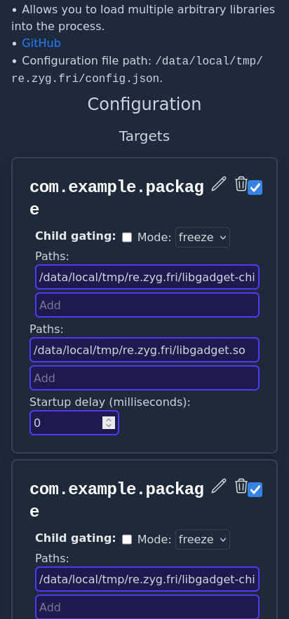
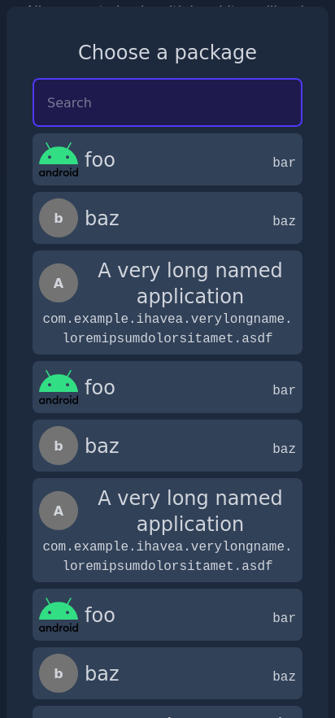

# ZygiskFrida Web UI

**WebUI X web UI for configuring [ZygiskFrida](https://github.com/lico-n/ZygiskFrida)**

Download from [GitHub releases](https://github.com/axelkar/ZygiskFrida-webui/releases).

## Screenshots

 

## Building

Built using [magisk-module-nix](https://github.com/axelkar/magisk-module-nix).

```sh
# build module zip
nix build .#magiskModule.installer
```
